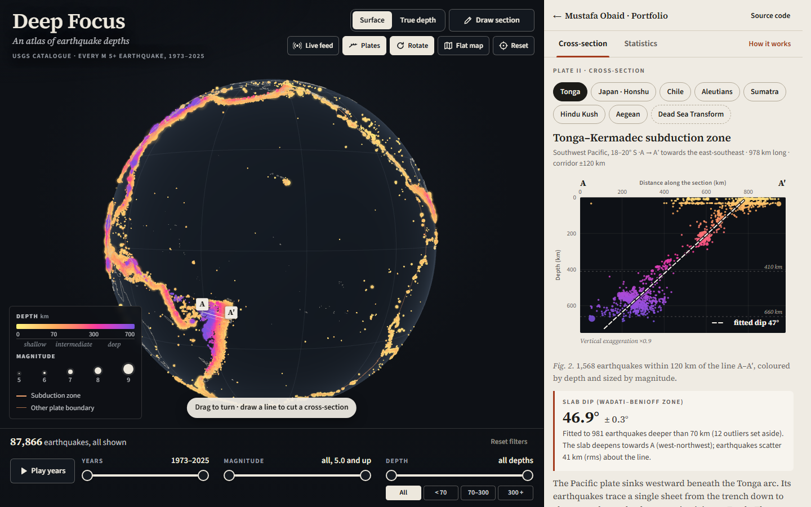
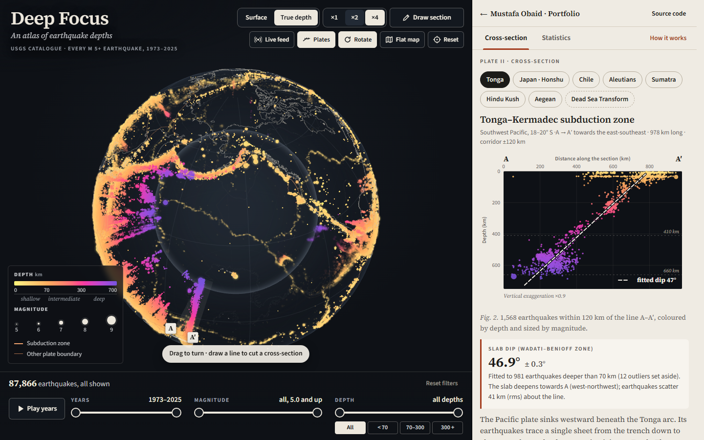
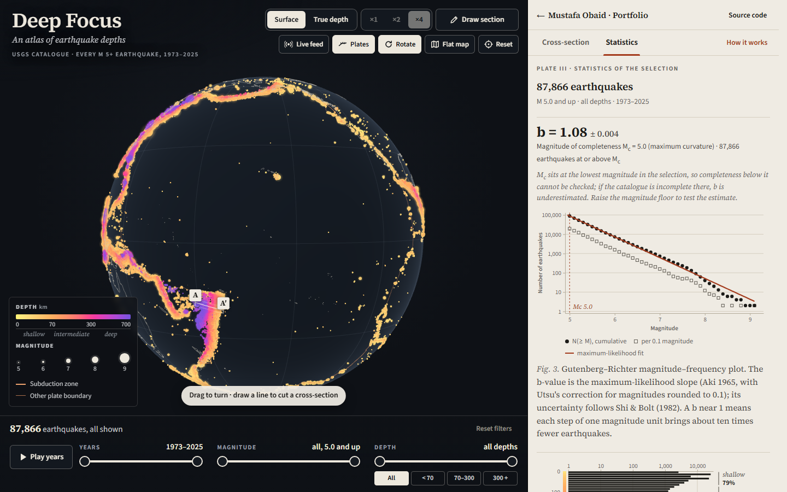

# Deep Focus — an atlas of earthquake depths

Every magnitude 5+ earthquake from 1973 to 2025 on a 3D globe: drop them to their true depths,
cut great-circle cross-sections that reveal plates diving into the mantle, and measure slab dips
and Gutenberg–Richter b-values for any selection.

**Live demo:** <https://mustafaobaidd1.github.io/deep-focus-earthquakes/>



## The question

Where do earthquakes happen, how deep are they, and what do their depths reveal about tectonic
plates sinking into the mantle? Most earthquakes are shallow, but around the Pacific some reach
700 km. Plotted at their true depths they line up into inclined sheets — the Wadati–Benioff zones
that trace subducting slabs. Deep Focus lets you see those sheets, slice through them, and put
numbers on what you see.

## Features

- **Globe** of 87,866 earthquakes (USGS ComCat, M ≥ 5.0, 1973–2025), coloured by depth with a
  perceptual, colour-blind-safe ramp (yellow → orange → magenta → indigo) and sized by magnitude,
  with Natural Earth coastlines and PB2002 plate boundaries (subduction zones highlighted).
- **Surface and true-depth modes.** True depth sinks every point to its hypocentre inside a
  translucent Earth (vertical exaggeration ×1, ×2 or ×4, default ×4), with the 660 km
  discontinuity drawn as a faint inner shell. Turning it on while looking at a section swings the
  globe round so the slab is seen edge-on.
- **Orbit controls**: drag, wheel or pinch zoom, inertia, slow auto-rotation (pausable; off under
  reduced motion), fly-to for presets, and keyboard control (arrows, + / −, 0).
- **Filters** for magnitude, depth (with shallow / intermediate / deep shortcuts) and years, with
  a play-through-the-years animation that accumulates events and highlights the latest twelve
  months. Counts, statistics and the section update live.
- **Cross-section tool.** Draw a great-circle line on the globe (or flat map), type the end
  points, or choose a preset: Tonga, Japan · Honshu, Chile, Aleutians, Sumatra, Hindu Kush,
  Aegean and — as a contrast — the Dead Sea Transform, a strike-slip boundary with no slab. Set
  the corridor half-width, switch to a true aspect ratio, and read the **fitted slab dip with a
  bootstrap uncertainty** for events below a chosen depth.
- **Statistics for the current selection**: Gutenberg–Richter plot with the maximum-likelihood
  b-value (Aki 1965 with Utsu's binning correction), Mc by maximum curvature, and the Shi & Bolt
  (1982) standard error; a depth histogram showing the shallow peak and the separate 500–700 km
  cluster; events per year; and the largest events in the selection.
- **Event details** on hover or tap (magnitude and type, depth, place, UTC time, epicentre) with a
  link to the USGS event page — also reachable from the largest-events list and by keyboard from
  the section chart.
- **Live layer**: the USGS feed of M ≥ 2.5 earthquakes in the past 30 days, cached for 15
  minutes, with designed loading, failed and stale states.
- **Flat-map edition** (Equal Earth, Pacific-centred) when WebGL is unavailable — or on request —
  with the same filters, picking, section drawing and statistics.
- **How it works** drawer: depth classes, subduction and Wadati–Benioff zones, deep-focus
  earthquakes, catalogue completeness, the b-value and the great-circle geometry, with typeset
  equations and the validation numbers below.

| True depth: slabs inside the Earth                                                                          | Statistics of the selection                                            |
| ----------------------------------------------------------------------------------------------------------- | ---------------------------------------------------------------------- |
|  |  |

## How it works

### Data

|            |                                                                                                                                                                                                                                                                                                                              |
| ---------- | ---------------------------------------------------------------------------------------------------------------------------------------------------------------------------------------------------------------------------------------------------------------------------------------------------------------------------- |
| Source     | USGS ANSS Comprehensive Earthquake Catalog (ComCat) via the FDSN event web service                                                                                                                                                                                                                                           |
| Query      | `https://earthquake.usgs.gov/fdsnws/event/1/query?format=csv&orderby=time-asc&minmagnitude=5&eventtype=earthquake&starttime=YYYY-01-01T00:00:00&endtime=YYYY-12-31T23:59:59.999` — one request per year, 1973–2025, sequential with a pause (the service caps a request at 20,000 events; the busiest year, 2011, has 2,701) |
| Fetched    | 2026-10-06 (`npm run fetch-data`; the log with every count, size and hash is `public/data/fetch-log.json`)                                                                                                                                                                                                                   |
| Counts     | 87,866 earthquakes; 1,077 (1998) to 2,701 (2011) per year; magnitudes 5.0–9.1; depths −3 to 700 km. Every yearly count matches the service's `/count` endpoint                                                                                                                                                               |
| Licence    | "USGS-authored or produced data and information are considered to be in the U.S. Public Domain" ([USGS copyrights and credits](https://www.usgs.gov/information-policies-and-instructions/copyrights-and-credits))                                                                                                           |
| Live layer | USGS real-time feed `earthquake.usgs.gov/earthquakes/feed/v1.0/summary/2.5_month.csv` (CORS, about 110 kB compressed), cached in `localStorage` for 15 minutes                                                                                                                                                               |

The bundled files are compact columnar binaries, byte-plane shuffled and gzipped:
`catalog.bin.gz` (683 kB: time deltas, latitude ×360, longitude ×180, depth ×10, magnitude ×100
and magnitude type), `details.tsv.gz` (776 kB of event ids and place names, loaded after the
globe is up), `coast.bin.gz` (65 kB, Natural Earth 1:50m simplified to 3 km) and `plates.bin.gz`
(14 kB, PB2002). Quantisation (≤ 0.006° and 0.1 km) is far below the catalogue's own location
uncertainty. The browser fetches them with a progress bar and decodes them in a Web Worker.

### Depth on the globe

The Earth is a sphere of radius _R_ = 6371.0088 km (IUGG mean radius). In true-depth mode an
event at depth _z_ sits at radius _R_ − _kz_, where _k_ is the vertical exaggeration. Colour
follows _t_ = √(_z_ / 700 km), which spends more of the ramp on the upper 100 km where most
earthquakes occur; the ramp is built in OKLCH with monotonically falling lightness, so depth order
survives greyscale and common colour-vision deficiencies, and every colour keeps ≥ 3:1 contrast
against the basalt background. Filtering happens on the GPU through uniforms that compare the same
integers (magnitude × 100, depth × 10, day number) as the worker, so the globe and the counts
always agree.

### Cross-sections

With unit vectors **a**, **b** to the section's ends and **p** to an epicentre,
**n** = **a** × **b** / ‖**a** × **b**‖ and **t** = **n** × **a**:

$$\delta = \arcsin(\mathbf{p}\cdot\mathbf{n}), \qquad \theta = \operatorname{atan2}(\mathbf{p}\cdot\mathbf{t},\ \mathbf{p}\cdot\mathbf{a})$$

*R*δ is the cross-track distance and *R*θ the along-track distance. An event belongs to the section
when 0 ≤ θ ≤ θ<sub>AA′</sub> and |*R*δ| ≤ the half-width; it is plotted at (*R*θ, depth). Great-circle
distances use the haversine formula,
$d = 2R\,\operatorname{atan2}(\sqrt{h}, \sqrt{1-h})$ with
$h = \sin^2\frac{\Delta\varphi}{2} + \cos\varphi_1\cos\varphi_2\sin^2\frac{\Delta\lambda}{2}$.
The chart always states its vertical exaggeration, or "true scale".

**Slab dip.** Events deeper than a threshold (70 km by default) are fitted by total least squares
— the principal axis of their covariance _C_ in (distance, depth), both in km:

$$\phi = \tfrac12 \operatorname{atan2}\!\left(2C_{xz},\ C_{xx} - C_{zz}\right), \qquad \text{dip} = |\phi|$$

Unlike regressing depth on distance this treats both coordinates alike and stays stable for
near-vertical slabs. Events more than 3 robust standard deviations (1.4826 × MAD, at least 10 km)
from a first fit are set aside and the line refitted. The uncertainty is the standard deviation of
the dip over 300 bootstrap resamples (fixed seed, so a selection always reports the same value).
No dip is reported with fewer than 15 deep events, or when the cloud has no dominant direction
(λ₂/λ₁ > 0.36).

### Magnitude–frequency statistics

Gutenberg–Richter law, log₁₀ _N_(≥ _M_) = _a_ − _bM_. Magnitudes are binned to Δ*M* = 0.1; _M_<sub>c</sub>
is the most populated bin (maximum curvature, Wiemer & Wyss 2000). The b-value is the maximum
likelihood estimate (Aki 1965) with Utsu's (1965) correction for binned magnitudes, and its
standard error follows Shi & Bolt (1982):

$$\hat b = \frac{\log_{10} e}{\bar M - (M_c - \Delta M/2)}, \qquad \sigma_b = 2.30\,\hat b^{\,2}\sqrt{\frac{\sum_{i=1}^{n}(M_i - \bar M)^2}{n(n-1)}}$$

(ln 10 = 2.3026 is used for their rounded 2.30.) At least 50 events at or above _M_<sub>c</sub> are
required. When _M_<sub>c</sub> equals the lowest magnitude in the selection the app says so, since
completeness below it cannot be checked.

## Validation

**What kind of tool this is:** an exploratory data tool on the authoritative USGS catalogue. The
statistical and geometric methods are validated against synthetic data with known answers and
published reference values; numbers for real selections are descriptive statistics of the
catalogue as published, not a research-grade seismological analysis. Unit tests: 84 (Vitest);
the broader runs below come from `npm run validate` (`src/generated/validation.json`).

| Check                                                | Reference                                                          | Result                                                                                                                                                                                             |
| ---------------------------------------------------- | ------------------------------------------------------------------ | -------------------------------------------------------------------------------------------------------------------------------------------------------------------------------------------------- |
| b-value MLE, 200 synthetic catalogues × 5,000 events | b = 0.8 / 1.0 / 1.2                                                | mean 0.799 / 0.995 / 1.191; worst error 0.050; **599 of 600 within ±0.05** (unit test: 5 seeds each for b = 1.0 and 0.8, all within ±0.05)                                                         |
| Utsu's binning correction                            | same catalogues, b = 1.0                                           | without it the mean would be 1.124                                                                                                                                                                 |
| Shi & Bolt σ                                         | empirical scatter of b over the 200 catalogues                     | ratio 1.04 / 0.997 / 1.02 (within 4%); ≈ Aki's b/√n = 0.014 for n = 5000                                                                                                                           |
| Mc by maximum curvature                              | 100 catalogues complete from M 5.0, steep detection roll-off below | 100 of 100 exact; a gradual roll-off is underestimated, as Woessner & Wiemer (2005) describe (unit test)                                                                                           |
| Slab dip (TLS + trimming + bootstrap)                | 60 synthetic slabs per dip, 400 events, 15 km scatter, dips 20–85° | mean error ≤ 0.7° (−0.7° at 20°, where the depth cut-off biases shallow slabs low); every fit within 1.13°; bootstrap σ matches the true scatter (0.25° vs 0.26° at 45°)                           |
| Haversine                                            | Rosetta Code BNA → LAX: 2886.444442837983 km (R = 6371)            | 2886.4444428379834 km                                                                                                                                                                              |
| Section projection                                   | 2,000 constructed points with known along/cross offsets            | max error 4.5 × 10⁻¹² km                                                                                                                                                                           |
| Data integrity                                       | USGS `/count` per year; ComCat values                              | all 53 years match; 87,866 unique ids; 2011 Tōhoku M 9.1 mww (38.297° N 142.373° E, 29 km), 1994 Bolivia M 8.2 mw (631.3 km) and 2013 Sea of Okhotsk M 8.3 mww (598.1 km) present with USGS values |

Results for the real catalogue (descriptive, for context): whole catalogue b = 1.079 ± 0.004
(_M_<sub>c</sub> = 5.0); deep events (≥ 300 km) b = 0.906 ± 0.014; 79.3% shallow, 15.9% intermediate,
4.8% deep. Fitted dips of the presets: Tonga 46.9° ± 0.3° (981 events), Japan · Honshu
27.8° ± 0.2° (78), Chile 32.4° ± 0.6° (571), Aleutians 57.5° ± 1.6° (45), Sumatra 42.0° ± 1.6° (130),
Hindu Kush 82.0° ± 1.2° (296), Aegean 21.3° ± 4.2° (24); the Dead Sea Transform has no event
below 70 km. These are mean dips of straight lines through bending slabs, over the corridor
chosen; they show the familiar contrasts (steep Tonga and Hindu Kush, shallow Japan) but were not
compared quantitatively with a slab model such as Slab2.

## Limitations

- Locations and depths are the catalogue's, not relocated: global M 5 epicentres are uncertain by
  roughly 5–15 km, and many depths are fixed defaults (10, 33 and 35 km) rather than measurements.
- The catalogue mixes magnitude types (mb 47%, Mw variants about 49%, Ms 4%) and four decades of
  changing networks; b-values compare selections, they do not measure stress. Maximum curvature
  underestimates _M_<sub>c</sub> for gradual roll-offs, and at the M 5.0 floor completeness cannot be checked.
- The dip is a single straight line through slabs that bend, tear or flatten; a corridor oblique
  to the trench shows an apparent dip shallower than the true one. The section chart unrolls the
  curved slice (surface distances are true; at 600 km depth horizontal distances are ~9% shorter).
- The Earth is a sphere (≈ 0.5% distance error against WGS84). True-depth mode exaggerates depth
  by default (×4) so slabs are visible; ×1 is true scale.
- The live layer shows the USGS feed as published (often preliminary) and is not included in the
  statistics, which describe the 1973–2025 catalogue only.
- The flat-map fallback has no true-depth mode. Hover picking is a CPU pass over all events per
  pointer move, and very old phones may render the 88,000 point sprites below 60 fps.

## Prior art

- **[Concord Consortium Seismic Explorer](https://seismic-explorer.concord.org/)** — a classroom
  tool with depth-coloured earthquakes, time animation, cross-sections and a 3D view. Deep Focus
  covers similar ground and adds a fitted slab dip with uncertainty on any section, b-value
  statistics for any selection, and a guided depth narrative.
- **[EarthScope/IRIS Earthquake Browser](https://ds.iris.edu/ieb/)** — browses millions of events
  (up to 25,000 per selection) with a 3D viewer, tables and exports; it is the better tool for
  pulling data. Deep Focus works on one fixed, fully bundled catalogue and adds sections, dip fits
  and magnitude–frequency statistics.
- **[USGS Latest Earthquakes](https://earthquake.usgs.gov/earthquakes/map/)** — the reference
  real-time map; no depth view, sections or statistics.
- **ZMAP** (Wiemer 2001, _Seismol. Res. Lett._ 72(3)) — a long-established MATLAB toolbox for
  catalogue statistics including b-values and Mc, far more complete for research; Deep Focus brings
  a small, validated subset of those methods to a browser.
- **Slab2** (Hayes et al. 2018, _Science_ 362:58–61) — the authoritative 3D slab geometry model;
  Deep Focus's dip is a simple statistic of the seismicity, not a slab model.

Deep Focus is a static site that works offline once loaded.

## Tech stack and architecture

Vite 8 · Svelte 5 (runes) · TypeScript (strict) · three.js (GPU point sprites with custom GLSL)
· D3 modules (scale, shape, axis, selection, geo) · KaTeX (lazy) · a Web Worker.

```
scripts/fetch-data.ts     USGS + Natural Earth + PB2002 → public/data/*.gz and fetch-log.json
scripts/validate.ts       long validation runs → src/generated/validation.json
src/lib/                  pure, unit-tested logic: CSV, codecs, geodesy, sections & dip fit,
                          statistics, filters, colour ramp, live cache, formatting
src/worker/               data worker: download + gzip, decode, statistics, sections, live CSV
src/globe/                three.js globe: shaders, orbit controls, picking, section curtain
src/map2d/                Canvas 2D Equal Earth map (fallback and optional view)
src/state/                Svelte 5 state, worker client, actions
src/components/           atlas UI: stage, toolbar, legend, filters, section and statistics plates
```

Initial JavaScript is 72 kB gzip (plus 8.5 kB CSS); the globe (141 kB gzip, mostly three.js) loads
in parallel with the 683 kB catalogue; KaTeX (86 kB) loads only with the method drawer. Rendering
stops when the tab is hidden and idles when nothing moves.

## Run locally

```bash
npm install
npm run dev          # http://localhost:5309/deep-focus-earthquakes/
npm test             # unit tests (Vitest)
npm run build        # production build into dist/
npm run test:e2e     # Playwright, desktop + mobile, against the preview server (port 5409)
npm run check        # lint, typecheck (svelte-check), Prettier, unit, build, E2E
npm run validate     # long validation runs, rewrites src/generated/validation.json
npm run fetch-data   # re-download the catalogue and map layers (cached in .cache/)
npm run screenshots  # README screenshots and the social card (after a build)
```

## Accessibility notes

- One `<h1>`, landmark regions, labelled controls; tabs, radio groups and sliders follow the ARIA
  patterns (arrow keys inside groups).
- Full keyboard path: the globe canvas turns with the arrow keys and zooms with + / −; sections can
  be cut from typed coordinates; the section chart is a slider that steps through its earthquakes
  (arrows, Page Up/Down, Home/End) and opens details with Enter; the largest-events list opens
  details for the biggest earthquakes in any selection.
- Visible focus rings on both the basalt and paper surfaces; touch targets of 44 px for primary
  controls on coarse pointers.
- Counts are announced politely after the sliders settle (not during playback); live-feed status
  and the dip result are live regions.
- Meaning never rests on colour alone: magnitude is size, depth is also the chart's axis and named
  in classes, live events are rings, and the ramp's lightness alone orders depth. Text contrast is
  at least 4.5:1; ramp colours keep ≥ 3:1 against the globe.
- `prefers-reduced-motion`: no auto-rotation, instant depth transitions and fly-tos, no pulsing,
  and playback steps a year at a time.
- Wide equations become focusable when they scroll; axe (WCAG 2.2 AA) runs in the E2E suite on the
  main page and the method drawer.

## Credits & licences

- Earthquake data: U.S. Geological Survey, ANSS ComCat — U.S. public domain.
- Coastlines: [Natural Earth](https://www.naturalearthdata.com/) 1:50m — public domain.
- Plate boundaries: P. Bird (2003), _An updated digital model of plate boundaries_, G³ 4(3), 1027;
  GeoJSON by Hugo Ahlenius, Nordpil ([fraxen/tectonicplates](https://github.com/fraxen/tectonicplates))
  — Open Data Commons Attribution License 1.0.
- Methods: K. Aki (1965), Bull. Earthq. Res. Inst. 43; T. Utsu (1965), Geophys. Bull. Hokkaido Univ.
  13; Y. Shi & B. A. Bolt (1982), BSSA 72(5); S. Wiemer & M. Wyss (2000), BSSA 90(4); J. Woessner &
  S. Wiemer (2005), BSSA 95(2); R. W. Sinnott (1984), haversine; B. Ottosson (2020), OKLab.
- Software: [Svelte](https://svelte.dev) (MIT), [three.js](https://threejs.org) (MIT),
  [D3](https://d3js.org) (ISC), [KaTeX](https://katex.org) (MIT), Vite, Vitest, Playwright, axe-core.
- Fonts: Source Serif 4 and Source Sans 3 by Adobe (SIL Open Font License 1.1), self-hosted via
  Fontsource.

## License

[MIT](LICENSE) © Mustafa Obaid
